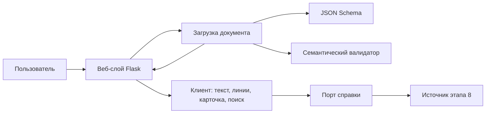

# Архитектура приложения

**Статус:** этап 2 закрыт как проектное решение 2026-10-17.  
Контракт JSON v1.0 не переоткрывается. Этот документ задаёт ответственность и интерфейсы. Он не утверждает, что код уже разложен по целевым модулям и что этапы 5–8 реализованы.

## Критерий

План этапа 2: выбран минимальный стек, разделены сервер, проверка, модель, справочник и клиент, зафиксированы интерфейсы, спроектированы экран и состояния ошибок.

Решения: [ADR-001](ADR/001-stack.md), [ADR-002](ADR/002-server-trust-boundary.md), [ADR-003](ADR/003-dictionary-port.md), [ADR-004](ADR/004-rendering-and-coordinates.md). Состояния экрана: [ui-states.md](ui-states.md).

## Поток данных



Браузер не вызывает синтаксический анализатор. Сплошные стрелки к источнику справки появляются только после этапа 8. До этого порт отвечает `not_configured`.

## Компоненты

| Компонент | Обязан | Не делает | Сейчас | Целевой модуль |
|---|---|---|---|---|
| Веб-слой | `GET /`, `POST /upload`, лимит 2 МиБ, HTTP-коды, шаблон, встраивание уже принятого документа | не чинит JSON и не назначает роли | `app.py`, `templates/index.html` | `app.py` только маршруты |
| Загрузка | UTF-8, JSON, схема, затем семантика; список ошибок без исключения наружу | не рисует страницу | функции внутри `app.py` | `src/document_loader.py` |
| Схема | форма и типы | не проверяет ссылки | `schemas/annotation.schema.json` | тот же файл |
| Семантика | коды из `docs/specifications/validation-rules.md` | не исправляет документ | `src/annotation_validator.py` | тот же файл |
| Модель | поверхность `text[start:end]`, обход токенов и предложений | не читает файлы и не знает про HTTP | срезы размазаны по `app.js` | `src/annotation_model.py` |
| Контекст слова | карточка, точная словоформа, лемма через `casefold`, группы ролей | не обращается к словарю и сети | черновик в `static/app.js` | правила в [ui-states.md](ui-states.md); проверка — Python на этапах 6–7, тот же алгоритм в клиенте |
| Справка | `lookup` и статусы `ok` / `unavailable` / `not_configured` | не влияет на код ответа страницы | модуля нет | `src/dictionary.py` |
| Клиент | таблица UTF-16, текстовые узлы, линии ADR-004, выбор токена | не считает серверную проверку необязательной | `static/app.js`, `static/app.css` | те же файлы, без сборщика |
| Тесты | схема, семантика, фикстуры; позже загрузка, контекст, отказ справки | не объявляются пройденными без запуска | `tests/` | туда же |

Вынос загрузки из `app.py` и появление `annotation_model.py` / `dictionary.py` — работа следующих этапов. Пока логика живёт в текущих файлах, границы из таблицы всё равно обязательны: справку нельзя встраивать в рисование текста, а роли нельзя вычислять из строки.

## Интерфейсы

Загрузка возвращает либо принятый объект контракта v1.0, либо отказ:

```text
load_bytes(raw, max_bytes=2*1024*1024) ->
    Accepted(document) |
    Rejected(http_status, errors: list[str])
```

Порядок внутри загрузки: размер, UTF-8, JSON, объект, JSON Schema, `validate_semantics`. Первая структурная ошибка останавливает семантику, чтобы сообщения не ссылались на заведомо чужую форму. Коды HTTP — в [ui-states.md](ui-states.md).

Семантика уже есть:

```text
validate_semantics(document: dict) -> list[ValidationIssue]
ValidationIssue = code, path, message
```

Контекст слова, когда появится проверяемая реализация:

```text
token_surface(text, token) -> str
other_occurrences(document, token_id, mode: "surface" | "lemma") -> list[RoleGroup]
RoleGroup = role: str | None, items: list[Occurrence]
Occurrence = token_id, surface, sentence_id
```

`surface` сравнивает строки кодовых точек как есть. `lemma` сравнивает `casefold`. Выбранный токен в список не входит.

Справка:

```text
lookup(lemma: str | None, surface: str) ->
    DictionaryLookup(status, source_name, text, search_url)
```

Целевой вызов клиента после выбора слова: `GET /dictionary?lemma=&surface=`. Ответ JSON со статусом выше. Нет этого маршрута — клиент показывает «источник не подключён» и не подставляет статью. Маршрут не реализуется в этапе 2.

Клиентские функции, даже если остаются в одном `app.js`:

```text
codePointToUtf16(text) -> table
renderText(document) -> text nodes and token buttons
renderCard(token) -> card fields and occurrence groups
```

Пользовательские строки не проходят через `innerHTML`.

## Что сознательно не входит

- Дуги по полю `head`.
- Учётные записи, база и история документов.
- Вторая координатная система в JSON.
- Выбор конкретного словаря. Для архитектуры достаточно порта из ADR-003.

## Проверка этапа

Этап считается закрытым, потому что стек, границы, сигнатуры и состояния записаны в файлах по ссылкам выше. Повторный `python3 -m pytest -q` после этой правки нужен только чтобы убедиться, что документы не задели тесты. Он не проверяет интерфейс в браузере и не проверяет ещё не написанные модули.
